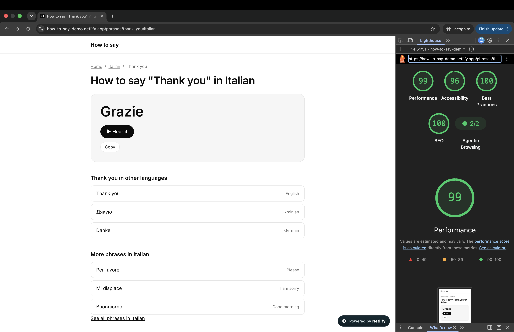

# How to say

A small static site with pages like "How to say thank you in Italian". Each page has the phrase, an audio player and links to the same phrase in other languages.

Live demo https://how-to-say-demo.netlify.app

## What it does

- 10 phrases in 4 languages (English, Italian, Ukrainian, German).
- 40 phrase pages made from one template and one JSON file (`data/phrases.json`).
- Audio is made once with the ElevenLabs API and saved as mp3 files. The live site only serves static files. It makes no API calls and needs no key.

## Tech

Next.js 16 (App Router), React 19 and TypeScript. All pages are generated at build time with `generateStaticParams`. Hosted on Netlify.

## URLs

| URL | Page |
| --- | --- |
| `/` | Hub with all languages and phrases |
| `/italian` | All phrases in one language |
| `/phrases/thank-you` | English phrase page |
| `/phrases/thank-you/italian` | Translation page with audio |

## SEO

- Unique title, description and canonical link on every page.
- `sitemap.xml` and `robots.txt` are generated in code.
- Custom 404 page. Unknown URLs return 404.
- JSON-LD with `BreadcrumbList` and `AudioObject`, checked with the Schema Markup Validator.
- Internal links. Hub, language pages, the same phrase in other languages, related phrases and breadcrumbs.
- Fonts load with `next/font` from the same domain.

## No thin pages

Every page has its own content. Phrase pages have a translation, audio and links. Language pages list real phrases. There are no empty pages and no copies, so there is nothing to hide from search engines. English has no translation page, because "thank you" in English is already the main phrase page.

## Performance

Lighthouse report for a phrase page, mobile.



## Tracking and A/B test

Events are pushed to `window.dataLayer`.

- `page_view`
- `play_audio`
- `copy_phrase`
- `next_page`

A live panel at the bottom of each page shows them. The first useful action is pressing play (`play_audio`).

A small feature flag runs one A/B test on the play button label, "Listen" or "Hear it". The variant is chosen at random, saved in `localStorage` and added to every event. Add `?variant=A` or `?variant=B` to the URL to force one.

## SQL

`analytics/funnel.sql` counts sessions that opened a phrase page, saw the button and pressed play, split by variant. `analytics/sample-events.csv` is made-up sample data. It is not real traffic and it does not show which variant is better.

## Run locally

Use Node 22.

```bash
npm install
npm run dev
```

## Make the audio

Add your key to `.env.local`.

```bash
ELEVENLABS_API_KEY=your_key_here
```

Run a dry run first. It prints the number of characters and sends nothing.

```bash
npm run audio
```

Then make the files. Files that already exist are skipped.

```bash
npm run audio:run
```
